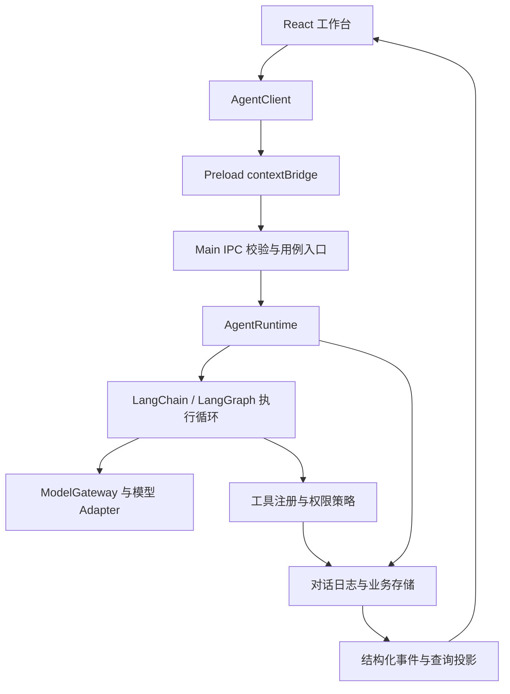

# Aster

> 一个本地优先的桌面 AI Agent 工作台：让用户在明确授权的项目中与 Agent 协作，并查看、审批和追溯实际执行过程。

Aster 的目标不是把模型回复停留在聊天窗口，而是形成一条受控的本地执行闭环：理解目标、读取项目、调用工具、展示变更与命令结果、持久化过程，并在需要时继续处理任务。

## 当前能力

- 项目与临时对话、快速协作、Subagent 和团队群聊；可查看成员执行过程、任务与交付。
- 本地文件读取、搜索、Patch、命令、终端、Web 搜索及受管浏览器等工具；文件、Diff 与执行结果可在工作区查看。
- 请求批准、帮我批准、完全访问三种权限模式，工具执行保留审批、取消、错误与恢复过程。
- 多供应商和模型配置、可用思考档位、MCP 与按需加载的 Skill；后台命名、摘要、审批及协调复用模型配置。
- 持久任务目录与对话执行清单；JSONL 历史、上下文压缩和实际请求用量／缓存统计。
- HTML、Vue、React 代码预览与截图检查；配置生图模型后支持文生图、参考图和多图生成，图片可放大及整段对话翻找。
- 同一 React 工作台作为 Electron Renderer 或浏览器 Mock 预览运行；浏览器预览不提供完整本机执行能力。

能力与限制以当前合同为准：权限见[业务上下文](./doc/14-业务上下文.md)，工具与 Skill 见[工具体系](./doc/11-AI工具体系与生命周期设计.md)，片段和生图见[普通对话工具与可视化验收](./doc/30-普通对话工具与可视化验收.md)。生图依赖供应商对当前凭证启用对应能力，模型出现在目录中不等于已有调用权限。

详细产品与架构事实见 [文档索引](./doc/文档索引.md)。规划中的能力会在设计文档中明确标注，不能视为已发布功能。

## 技术栈

- Electron 43 + TypeScript 6：桌面主进程、Preload 与本机能力。
- React 19 + Vite 8：工作台界面。
- LangChain / LangGraph：Agent 执行编排。
- Zod 4：跨进程与外部输入合同校验。
- JSONL：对话属性、消息和完整事件历史；SQLite：项目、团队等业务事实与执行检查点。
- pnpm 10：Monorepo 工作区管理。

## 架构与数据流



Renderer 只通过 AgentClient 访问类型化宿主能力；Preload 暴露具名 API，Main 校验输入并编排模型、工具和持久化。模型适配、路径权限、事务与窗口生命周期由各自模块负责，React 不直接访问 Node 或数据库。〔FACT｜`apps/desktop/src/preload/index.ts:5`、`apps/desktop/src/main/agent/agent-runtime.ts:303`、`apps/desktop/src/main/agent/langgraph-executor.ts:753`〕

对话完整历史追加到 JSONL，SQLite 的会话查询临时投影可以重建，不是第二份持久历史；配置统一保存在 `settings.jsonc`，密钥不进入模型上下文。产物与附件保存在应用管理目录或已授权工作区，通过受控引用读取。具体目录与备份边界见 [Aster 目录结构与 JSONC 配置](./doc/24-Aster目录结构与JSONC配置.md)。〔FACT｜`apps/desktop/src/main/storage/thread-log.ts:156`〕

## 仓库结构

以下为当前源码组织，规划中的独立 Runtime／Storage 包尚未建立；当前共享包只有 `protocol`。〔FACT｜`pnpm-workspace.yaml:1`；目录核对：2026-10-19〕

```text
apps/
  desktop/src/
    main/
      bootstrap/ ipc/           装配、生命周期与 IPC 边界
      agent/ model/            Agent 循环、上下文、模型网关与适配
      storage/                 SQLite、JSONL、附件与清理
      tools/ security/         本机工具、路径和权限原语
      teams/ tasks/ projects/ schedules/  业务域
      plugins/ settings/ preview/         扩展、配置与片段预览
      windows/ computer-use/ control/ errors/  宿主能力与控制接口
    preload/                   Renderer 的受控桥接 API
  web/src/
    app/                       应用装配与 Provider
    features/                  chat、projects、schedules、settings、tasks、team、workspace
    components/                ui、layout 及 editor、markdown、media、html-preview、diff
    runtime/                   AgentClient 与 Desktop/Mock Adapter
    stores/ lib/ styles/       UI 状态、共享纯函数、主题 Token 与基础样式
packages/protocol/src/         跨进程 Schema、DTO 与共享合同
scripts/                       开发启动、控制 CLI、原生依赖与打包校验
doc/                           产品、架构、接口和工程规范
.github/                       手动 CI 与 PR 模板
```

测试与实现共置为 `*.test.ts`／`*.test.tsx`。页面私有实现留在所属 Feature，跨 Feature 共用组件放入 `components/<capability>`；后端方法先在所属业务域复用，满足实际条件后再拆独立包。新建目录、文件命名和文件规模要求见[模块与编码规范](./doc/06-前后端模块与编码规范.md)。

全部功能页使用 `AppShell`／`WorkbenchLayout` 的共同外层；设置的菜单和内容属于内层，按 `general`、`models`、`permissions`、`mcp`、`skills` 等目录组织，设置内通用组件位于 `features/settings/components`。聊天的时间线投影、工具结果解析与展示、附件和错误展示留在 `features/chat` 的具名模块中，工作区继续管理状态与事件。Main 的 Runtime 和 Database 保留原业务入口；工作区工具装配、重连观察策略、数据库 schema／迁移与已有合同、映射、日志读取分别组织。实施范围与剩余大文件见[结构整理记录](./doc/OBSERVATIONS.md#第二批结构实施2026-10-19)。

后续拆分将侧边预览／文件队列、导航交互、编辑器 Widget 分别留在所属功能目录；Main 的 IPC 按领域注册并共享来源／Schema／错误校验，模型回放／消息转换与配置迁移、日志上下文投影及具名仓储独立归属。模型页保存队列可跨页面生命周期保留最后修改，Agent 能力选择读取真实集成目录。当前进展与未完成边界见[第三批审查记录](./doc/OBSERVATIONS.md#第三批结构与行为复核2026-10-19)。〔FACT｜`apps/web/src/features/settings/models/model-settings-save-queue.ts:11`、`apps/desktop/src/main/ipc/register-main-ipc.ts:1`〕

## 开始开发

### 前置条件

- Node.js `>=24 <25`（见 [`.node-version`](./.node-version)）
- pnpm `>=10 <11`
- Windows 为当前主要开发与验证平台

```powershell
corepack enable
pnpm install
pnpm dev
```

`pnpm dev`（或 `pnpm start`）是日常开发的默认入口：启动 Vite、Main/Preload 编译监听和 Electron。React/CSS 修改由 Vite 热更新，Electron 主进程 PID 保持不变；Main/Preload 修改才自动重启 Electron。Web Renderer 地址为 `http://127.0.0.1:5173`。

开发启动会验证 Vite 来自当前 worktree；端口被其他 worktree 占用时明确失败，不复用另一份页面，也不回退到旧 `dist`。并行 worktree 可指定独立端口：

```powershell
$env:ELECTRON_RENDERER_URL = "http://127.0.0.1:5174"
pnpm dev
```

不要用 `electron .` 或直接执行 Electron 替代开发脚本。

从后台创建、发送、读取对话可显式启用 `ASTER_CONTROL_ENABLED=1`，再用 `pnpm control` 或 HTTP 接口；桌面通过同一事件链实时感知。调用和连接方式见[本机控制接口与终端调用](./doc/25-本机控制接口与终端调用.md)。

`pnpm control --connection "<连接文件路径>" verify` 自动完成创建对话、两轮真实模型调用、事件与保存历史核对，全程无需操作页面。`pnpm test:control` 提供隔离且稳定的 CLI/HTTP/Runtime/前端事件回归；真实模型验收的启用方式见上述文档。

启动日志会显示源码绝对路径、分支和提交。继续尚未合并的功能时，必须在包含该功能最新改动的 worktree 中启动；共享 `develop` 或其他修复分支不包含未合并界面，不能把它们的验收窗口当成最新版本。

### 构建、生产预览与 Windows 打包

| 命令 | 用途 | 热更新／产物 |
| --- | --- | --- |
| `pnpm dev` / `pnpm start` | 日常开发和桌面 UI 验收 | Vite HMR；Main/Preload 自动重启 |
| `pnpm build` | 生产编译，完整类型检查另跑 `pnpm typecheck` | `apps/web/dist`、`apps/desktop/dist`；不启动、不打安装包 |
| `pnpm preview` | 构建后启动本地生产产物 | 静态文件；明确无热更新 |
| `pnpm package:dir` | 构建并生成 Windows x64 解包目录 | `release/win-unpacked/Aster.exe` |
| `pnpm package:win` | 构建并生成 Windows x64 NSIS 安装包 | `release/Aster-<version>-x64-setup.exe` |

打包包含 Renderer、本地运行依赖和 Electron，不要求目标机器安装 Node、pnpm 或运行 Vite。开发服务环境变量不会让安装包加载开发页面。打包默认只产出本地制品，不上传 GitHub Release；正式发布的签名、版本标签与更新链路另行配置。Windows 安装包在 Windows 上构建和验证。

打包前用目标 Electron 验证 `node-pty` 的 Node-API 预编译文件和 ripgrep；打包后自动运行 `pnpm verify:package`，检查包内 Renderer、终端原生模块及搜索可执行文件。ripgrep 使用 `app.asar.unpacked` 的实际路径。配置与依赖版本按 [electron-builder 26 文档](https://www.electron.build/v26/docs/) 固定；目前使用默认 Electron 图标，代码签名和产品图标可在正式发布前补齐。

可选的本地模型环境变量放在仓库根目录 `.env.local`；该文件已被 Git 忽略，绝不提交真实密钥。

```dotenv
AGENT_MODEL_BASE_URL=https://example.com/v1
AGENT_MODEL_API_KEY=replace-with-your-key
AGENT_MODEL_ID=your-model-id
```

## 验证命令

```powershell
pnpm lint
pnpm typecheck
pnpm test
pnpm build
```

提交前还应执行：

```powershell
git diff --check
git status --short
```

当前 CI 仅支持维护者手动触发，PR／推送不会自动运行这些检查。只修改 Markdown 时检查文档链接、事实与目录一致性及 `git diff --check`；源码变更按影响范围完成测试和根级门禁。详见[贡献指南](./CONTRIBUTING.md)。〔FACT｜`.github/workflows/ci.yml:1`〕

## 贡献与协作

本仓库使用 Git Flow：`main` 是已发布基线，`develop` 是下一版本集成线，日常工作从 `feature/*` 或 `fix/*` 分支通过 PR 合入。完整约定见：

- [贡献指南](./CONTRIBUTING.md)
- [Git 与 GitHub 协作规范](./doc/18-Git与GitHub协作规范.md)
- [前后端模块与编码规范](./doc/06-前后端模块与编码规范.md)：目录、命名、组件归属与文件规模。
- [后端编码规范](./doc/13-后端编码规范.md)
- [界面迁移与设计系统规范](./doc/07-界面迁移与设计系统规范.md)

先读总规范，再按改动范围读 UI／后端规范。手写业务源码新增或重构后必须少于 1,000 行，达到组件约 250 行、普通 TS 约 400 行时即评估职责拆分；现有超限文件不代表允许继续堆积。配色、布局和控件复用已有设计系统，性能优化须有对应场景的测量与回归证据。

请不要直接向 `main` 或 `develop` 推送，也不要在公共分支上改写历史。

## 发布状态

当前仓库提供本地 Windows x64 安装包和解包目录构建入口，尚未配置代码签名、自动发布或自动更新。发布与更新方案会以 GitHub Release 为制品来源；标签触发发布和 Stable/Beta 更新通道仍为规划，不能视为已实现。未配置证书的本地安装包未签名。

公开发布前仍需由项目负责人确认：

- GitHub 组织/仓库名与域名。
- 开源许可证或商业许可策略。
- Windows 代码签名证书，以及未来 macOS 的签名与公证账户。
- 首发支持的平台、架构与 Beta 用户范围。

## 安全说明

本软件能够在用户授权范围内访问本地项目并运行命令。使用前请审阅权限设置；不要把 API Key、访问令牌、私钥或包含敏感信息的 `.env` 文件提交到仓库或粘贴到 Issue/PR。

安全问题请勿通过公开 Issue 披露。在安全披露渠道确定前，请直接联系仓库维护者。
