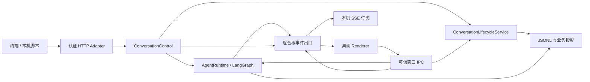

# 本机控制接口与终端调用

状态：2026-10-14 已实现本机 HTTP 调用、终端命令与实时事件；手机远程访问尚未实现。

## 启动与连接

在应用所属 worktree 的 PowerShell 中显式启用接口：

```powershell
$env:ASTER_CONTROL_ENABLED = "1"
pnpm dev
```

Main 仅监听 `127.0.0.1` 的随机端口，每次启动生成随机令牌，将 `{schemaVersion:1,url,token,pid}` 写入 Electron `userData/local-control.json`。启动日志只输出连接文件位置。`ASTER_HOME` 指定数据目录时，该文件位于其 `electron-profile/` 下。退出关闭接口、订阅及连接文件；开发重启后客户端须重新读取文件。默认启动不开启接口。

并行 worktree 使用同一地址驱动 Vite、等待端口和 Electron：

```powershell
$env:ELECTRON_RENDERER_URL = "http://127.0.0.1:5177"
pnpm dev
```

并行验收使用独立 `ASTER_HOME`，避免同实例锁、配置或日志混用。启动日志中的源码目录、分支、提交和 HTTP Renderer 必须对应验收目标。

## 终端命令

`--connection` 指向启动日志列出的连接文件，也可用 `ASTER_CONTROL_FILE` 环境变量指定。JSON 可直接传入；PowerShell 和批处理环境推荐保存请求文件，再用 `@文件路径` 传入，以免 Shell 改写引号。

```powershell
$env:ASTER_CONTROL_FILE = "<启动日志中的连接文件路径>"
pnpm control list
pnpm control projects
pnpm control create
```

创建返回包含 `id` 的 ConversationSummary；默认使用当前启用的默认 Agent、新对话权限和首选模型。项目对话或其他 Agent 的创建请求文件示例：

```json
{"projectId":"<已登记项目 UUID>","agentId":"default-agent"}
```

```powershell
pnpm control create "@create.json"
```

发送请求文件：

```json
{"conversationId":"<创建返回的 UUID>","content":"检查当前项目","deliveryMode":"queue"}
```

```powershell
pnpm control send "@send.json" --wait
pnpm control watch
```

`send --wait` 在发送前建立订阅，先输出提交结果，再输出当前对话事件，直到对应 Run 结束。队列消息通过 `pending_messages.updated.consumedMessages` 关联实际 Run。成功退出码 0；失败、取消、连接中断或 120 秒等待超时退出码 1。超时或客户端退出不会取消 Run，也不会自动重试发送。工具等待审批时可在桌面处理，事件流会显示其状态。

读取或停止请求文件：

```json
{"conversationId":"<对话 UUID>"}
```

```powershell
pnpm control read "@conversation.json"
pnpm control cancel "@conversation.json"
```

`read` 返回最近 120 项 Timeline（上限 200）。用现有 `beforeSequence`、`afterSequence` 或 `aroundItemId` 分页，三个游标只能选择一个。`cancel` 沿用对话级停止，涵盖嵌套 Subagent、等待及待执行唤醒，保留历史。

## 无需操作页面的完整验收

当前桌面开发进程启用本机接口并配置可用模型后，运行：

```powershell
pnpm control --connection "<连接文件路径>" verify
# 可选：绑定现有项目或 Agent；请求结构沿用 create
pnpm control --connection "<连接文件路径>" verify "@create.json"
```

`verify` 会真实创建一条对话并调用模型两轮，保留验收历史。流程为：先连接 SSE → 创建对话并收到摘要广播 → 发送第一轮 → 等待流式回复和 Run 完成 → 发送第二轮 → 读取历史，核对两条用户消息及两条非空助手回复。输入固定为验收短消息，要求模型直接回答且不调用工具。成功输出 `verification.finished`，包含 `ok:true`、对话 ID、两个 Run ID 和消息数量。任一 Run 失败/取消时停止后续发送并以退出码 1 结束；缺失创建广播、流式事件、完整历史或等待超过 120 秒也视为失败。超时不取消后台 Run；`verification.created` 提供的对话 ID 可用于 `read` 或 `cancel`，不自动重试或删除测试对话。

这里验证的是命令、事件和保存的历史；后台创建不会强制切换桌面当前选中的对话。桌面使用相同事件出口更新列表和运行状态，用户随后打开该对话即可看到历史。无需鼠标、键盘输入、数据库文件监控或刷新页面来发送消息。

仓库另提供稳定的自动测试入口，不依赖真实模型或桌面窗口：

```powershell
pnpm test:control
```

该命令包含 CLI 成功/失败与历史缺失检查、真实 Runtime/HTTP/子进程 CLI 集成测试，以及 React 对后台事件的响应测试。CLI 集成测试可显式使用真实模型：设置 `ASTER_CONTROL_TEST_MODEL_FILE` 为仓库外私有 JSON 文件路径，内容仅含 `baseUrl`、`apiKey`、`modelId` 和可选 `apiFormat`（默认 `openai-chat-completions`），然后运行同一命令。测试使用隔离的临时数据并自动清理，不修改桌面用户模型配置；完成后移除环境变量和私有凭据文件。该开关只属于自动测试，不改变产品端口或权限。

2026-10-14 实测：使用用户提供接口的 `gpt-6-luna`，独立 CLI 进程经真实 HTTP/Runtime/LangChain Adapter 完成两轮回复、实时事件和四条历史消息检查。原桌面默认配置的 `gpt-5.6-luna` 曾返回 HTTP 400 `unknown provider for model`，该配置错误不作为控制链路成功结果。认证信息和实际用户数据不进入仓库或验收报告。

## HTTP 合同

`POST /v1/commands`，请求头为 `Authorization: Bearer <token>` 与 `Content-Type: application/json`，请求正文：

```json
{"command":"conversations.create","input":{}}
```

| command | input | 成功响应 |
| --- | --- | --- |
| `projects.list` | `{}` | ProjectSummary[] |
| `conversations.list` | `{}` | 完整 ConversationSummary 层级 |
| `conversations.create` | 可选 `projectId`、`agentId` | ConversationSummary |
| `conversations.read` | ConversationTimelinePageInput | ConversationTimelinePage |
| `messages.send` | `conversationId`、非空 `content`、可选 Queue/Steer `deliveryMode` | ConversationMessageSubmission |
| `runs.cancel` | `conversationId` | `{cancelled:true}`，表示已调用停止流程 |

输入严格校验；正文最大 1 MiB，消息最大 100,000 字符。创建仅绑定已启用的配置 Agent；发送保留对话的模型选择和权限，默认投递模式来自应用设置。托管团队执行对话沿用 `TeamWorkItemRuntime.sendExecutionGuidance`。客户端不能传入任意工作区、模型、Agent 指令或权限覆盖。

非法 JSON/合同返回 400；认证、Origin 或 Host 不符返回 403；未知端点 404；过大正文 413；媒体类型错误 415；业务调用失败 500 并返回安全的 `error.code/message/retryable/instanceId`。副作用命令不自动重试。接口不开启 CORS，拒绝所有带 Origin 的请求；连接文件属于当前本机用户的凭据。

## 事件与恢复

`GET /v1/events` 使用相同 Bearer 认证，返回 SSE。最多同时 16 个订阅，慢消费者会断开，不能阻塞 Agent 执行。

连接的第一个事件：

```text
event: ready
data: {"instanceId":"<本次进程 UUID>","snapshotRequired":true}
```

后续 `event: conversation` 的 `data` 是已有的 ConversationRunEvent，`id` 为 `<instanceId>:<进程序号>`。包含对话摘要、Run 开始/终态、Assistant 流式正文、工具、审批、Queue/Steer 与其他 Runtime 事件。IPC、后台命令、定时任务和运行恢复均经组合根的同一事件出口，同时发给桌面 Renderer 和本机订阅。后台创建在持久化完成后发布 `conversation.updated`；页面的现有订阅直接插入列表，已打开对话在 `run.started` 时加载用户消息，随后消费流式回答。

事件流当前不持久化、不重放，不支持 `Last-Event-ID` 补偿。每次连接先订阅，再查询对话列表和需要的 Timeline，按 Conversation/Timeline ID 合并快照及随后事件。断线期间的完整事实从 JSONL/现有投影读取；Run 中尚未持久化的文本增量只保留实时性，终态会落盘。重启会改变令牌和 `instanceId`。



## 手机与交互终端的后续工作

终端界面可使用这些命令和事件，界面状态来自列表/Timeline 快照，无需监控数据库或修改日志文件。需要的钩子已是持久化之后的 `ConversationRunEvent` 出口：创建、Run 状态、正文增量、工具/审批、待发送队列均从同一处发布，IPC 和 SSE 只是不同传输适配器。

手机接入需要在独立传输层增加设备配对、加密连接、可撤销的设备认证、断线补偿及请求去重；写命令仍通过当前应用入口和审批规则。客户端先订阅再拉快照，不能在网络失败后盲目重新发送副作用命令；远程版本需要持久化命令 ID 与对应结果，按设备/请求 ID 去重，并补上事件游标或明确的快照恢复。当前本机令牌与 HTTP 监听不直接开放到局域网。远程审批、附件传输和交互终端 UI 尚未实现。
