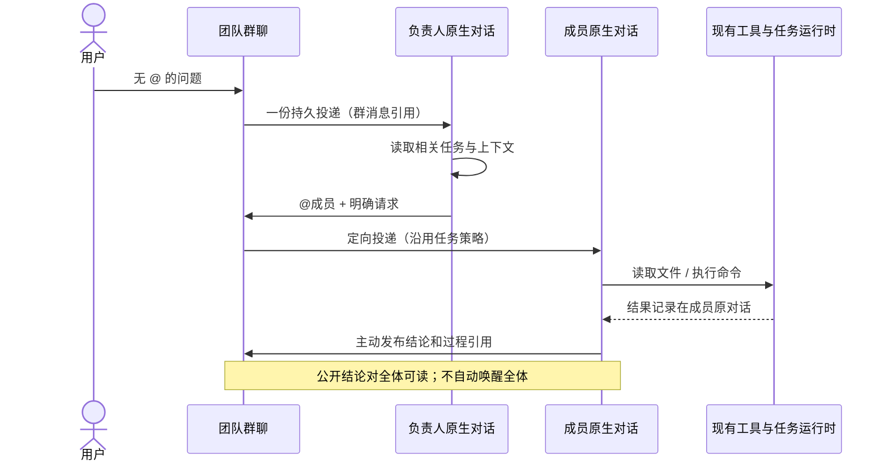

# 任务上下文目录与团队群聊方案及推演

> 状态：实施前设计；本文件中的目标行为尚未在功能代码中实现。
>
> 日期：2026-10-16。类型：联合功能方案，包含产品规则、概要设计、实施顺序和验收场景。
>
> 基线：用户指定的「移除代码块最小高度限制」对话所用活跃分支 `codex/desktop-feature-iterations`，提交 `33b5ab85265ad7c0854a8750a638b42ae12871b2`。本任务使用独立分支 `codex/task-context-team-chat`，不修改该对话的工作树或运行窗口。
>
> 标记：`〔FACT〕` 是在上述基线核对过的代码事实；`〔DESIGN〕` 是本次确定的目标行为；`〔INFER〕` 是推演得出的取舍。设计和推演不等于实现或测试通过。
>
> 相关文档：[团队与任务调度](./05-多Agent团队与任务调度设计.md)、[接口与数据](./02-前后端接口与数据约定.md)、[业务上下文](./14-业务上下文.md)、[上下文与压缩](./16-对话存储、上下文与压缩设计.md)、[JSONL 对话存储](./22-JSONL对话存储与归属设计.md)。

## 1. 目标与范围

### 1.1 用户要解决的问题

1. 看清已经做过哪些任务、正在做什么、结论和下一步是什么；跨轮次、跨对话继续时保留目标、约束和有效决定。
2. 展开一项任务，追溯实际相关消息、执行过程与验证结果；普通使用不要求逐条翻历史。
3. 团队拥有共享群聊；负责人和成员可以思考、查文件或执行命令后，再决定是否向群里发消息。
4. 群消息对成员共享可读，但只唤醒需要行动的人。没有明确接收者的用户消息由负责人协调。
5. 复用当前 Conversation、Run、WorkItem、通信、Queue/Steer、回执、ThreadLog 和上下文预算机制。

### 1.2 首批完成边界

普通对话、持久 Agent、临时 Subagent 和团队成员统一使用任务目录。团队实例提供共享群聊、任务目录、定向 @、过程跳转和必要的投递状态。个人和团队视图查询同一批任务记录。任务目录的检索、维护和群聊发言通过现有工具注册与运行入口提供。〔DESIGN〕

本批不增加自由竞争发言、全员逐条分类、独立路由模型、独立 Agent Loop、语义向量库、自动跨项目合并、历史消息全量自动归档、自动 Git 合并或新权限模式。岗位扩缩容和快速协作队列不与本批捆绑。〔DESIGN〕

## 2. 当前实现与复用点

| 已有机制 | 已核对的事实 | 本次复用方式 |
| --- | --- | --- |
| 当前任务清单 | 每个 Conversation 保存一份活动清单；关闭后移除当前投影；模型请求前注入活动状态 | 继续记录执行步骤；长期任务目录只保存任务归属和概要，不把每条步骤升级为一个任务 |
| 隐藏轮次摘要 | 已完成 Run 的摘要用于后续压缩，按 `runId` 保存 | 作为生成任务进展的有界素材，不将 Run 直接等同于任务 |
| Team WorkItem | 已有需求、结果、参与关系、事件、返工和用户验收 | 团队执行的任务目录项引用既有 WorkItem；实际调度和验收仍由 WorkItem 决定 |
| Agent 通信 | `send_agent_message`、读取对话、完成回执与唤醒已存在 | 定向投递复用现有链路，携带群消息和任务关联；共享可见消息不逐成员发送 |
| 成员原生对话 | 成员拥有自己的持久 Conversation 和运行历史 | 文件、命令、工具、进度及内部工作记录仍进入成员自己的对话 |
| 持久化和恢复 | 对话原文与执行历史使用 ThreadLog JSONL；业务数据库保留团队等事实 | 不重建消息存储系统；新增任务目录与团队群聊业务记录明确唯一事实来源 |
| 团队页面 | 当前有需求看板、任务与验收、执行规划三个模式 | 增加群聊和任务目录入口，保留原有看板、成员对话与协作图 |

证据：`packages/protocol/src/conversation.ts:247`；`apps/desktop/src/main/storage/agent-database.ts:5977`；`apps/desktop/src/main/agent/task-list-context.ts:12`；`apps/desktop/src/main/agent/agent-runtime.ts:5778`；`apps/desktop/src/main/agent/agent-communication-tool.ts:96`；`apps/web/src/features/team/team-workspace.tsx:602`。〔FACT〕

独立分支 `codex/team-reliability` 的提交 `d05a55c` 包含团队 WorkItem 时间线及按成员筛选的 `get_team_context`，尚不在本基线。它没有通用的跨对话任务目录，也没有本方案的群聊。实施时按需迁用查询和展示思路，不直接合入其中的扩缩容、权限默认值等其他功能。〔FACT｜`git branch --contains d05a55c`，该提交的 `getTeamTaskContext` 与 `TeamTaskTimeline`〕

### 2.1 必须处理的现有边界

- `handleAgentMessageSent` 会调用 `startUnreadAgentMessageRun`；仅把消息类型设成 notification 并不能代表绝不唤醒。群聊广播不能循环调用它。〔FACT｜`apps/desktop/src/main/agent/agent-runtime.ts:3745`、`:3814`〕
- 现有完成回执按发送方对话合并；同一 Run 若处理同一发送方的多个群请求，需要另外保留每条请求与任务的对应关系。〔FACT｜同文件 `:3687`〕
- 活跃 WorkItem 的成员指导复用 Steer，不能直接开启第二个独立 Run 或替换执行策略。群聊投递必须遵守同一限制。〔FACT｜`apps/desktop/src/main/teams/team-work-item-runtime.ts:470`；`apps/desktop/src/main/agent/agent-runtime.ts:1551`〕
- Conversation 的队列、压缩序号和消息定位各有语义，不能用可重新编号的页码或数组下标作为跨对话引用。〔FACT｜`doc/16-对话存储、上下文与压缩设计.md` 第 3.3、3.4 节〕

## 3. 统一任务目录

### 3.1 任务与展示

一项任务是持续的用户目标，有明确范围和完成条件。继续讨论、查证、实现、检查和返工可以属于同一任务；问候、收到、普通状态通知不自动产生任务。模型根据目标和完成条件判断，不能只用标题或关键词判重。〔DESIGN〕

```text
修复浏览器遮挡弹框 · 进行中 · 后端 / 测试
  ├─ 来源对话 A：最初报错消息
  ├─ 后端对话 B：定位、工具记录与修复结果
  ├─ 测试对话 C：回归结论
  └─ 群聊：验收反馈与返工要求
```

UI 只展示两层：第一层任务，第二层相关消息或执行段。第二层可按来源对话折叠，但不增加任务子树。展开前显示标题、状态、最近有效结论、负责人、参与者和更新时间。默认按更新时间倒序，支持查询、状态筛选和游标翻页。〔DESIGN〕

任务记录只有一份。个人视图按创建者或参与 Conversation 查询；团队视图按团队实例和参与任务查询。`AgentProfile` 是配置模板，同一模板在不同团队、项目中的实例不能被当成同一个成员。〔DESIGN〕

### 3.2 目标数据合同

名称为设计名，实施时放进最接近的现有协议模块，不新增通用管理框架。〔DESIGN〕

| 对象 | 必要字段与约束 |
| --- | --- |
| TaskContext | 稳定 `id`、标题、目标/完成条件、状态、当前简述、有效决定/约束、下一步、创建者、负责人、参与 Conversation、主项目（可空）、所属 TeamInstance（可空）、WorkItem 引用（可空）、创建/更新时间、修订号 |
| TaskSourceRef | `taskContextId`、来源种类 conversation/group、来源 Conversation 或 Room、稳定消息 ID、可选 Run/工具 ID、用途（请求/决定/进展/结果/验证）；唯一引用去重，不复制完整原文 |
| RunTaskBinding | 本次请求或执行段绑定的任务、来源消息与成员；一个 Run 可以服务多个任务，不能只保存一个 Conversation 级的可变 taskId |

任务目录是跨对话业务事实，新增到现有 `db.sqlite`，由 AgentDatabase 所属存储模块管理。原始用户、Assistant、工具消息继续只以所属 Conversation 的 JSONL 为准。任务目录保存概要和稳定引用，不再保存一份完整对话。Conversation 的持久身份来自 JSONL，SQL 关联不能外键依赖可重建的临时对话投影表；保存时通过现有生命周期读取校验，删除后记录来源失效。〔DESIGN〕

与 WorkItem 关联的目录项以 `workItemId` 唯一对应；状态、验收、返工结果从 WorkItem 投影，不提供另一套可冲突的调度状态。普通任务使用 pending/running/blocked/completed/failed/cancelled 的有限状态；“模型声称完成”与“用户已经验收”单独表述。〔DESIGN〕

### 3.3 创建、复用与维护

1. 当前请求有明确任务 ID、回复来源或委派关联时，优先继承；仍需识别用户是否明确更换目标。
2. 无明确关联时，模型先查询本作用域的活跃任务与相关历史候选；默认每页最多 20 条，禁止每次读取完整目录。
3. 同一目标继续：携带已有 ID 更新进展并绑定本次来源。新目标：创建新项。目标明显不同不强行归并；跨项目仅因文字相似不自动合并。
4. 用户输入、委派、工具证据、最终输出由 Runtime 根据已确认的绑定自动登记引用。模型维护简述和有效决定，不逐条手工抄写工具日志。
5. 新结论、撤回方案或返工更新同一项；替代旧决定时保留修订与来源，当前摘要只呈现有效决定。
6. 未调用任务工具或无法判断时，来源保留“未归类”状态供后续关联，不宣称系统已保证正确归档；不会按每条消息悄悄创建一个兜底任务。

同一请求的重放按来源消息 ID/ToolCall ID 幂等；`expectedRevision` 拒绝旧摘要覆盖新结论。不同来源的语义重复不能靠唯一键完全解决；并发新建需在复查后明确合并，保留旧 ID 到主项的跳转，不静默丢弃证据。〔DESIGN〕

普通任务由创建它的主对话维护总体摘要，团队任务由负责人维护；成员提交带来源的进展和结果，不直接覆盖总体目标、约束和他人的结论。任何合法修订遇到旧版本都返回冲突，重新读取后再决定，不盲目重试旧全文。模型判断“同一任务”的语义仍可能错误，UI 应允许用户纠正关联和归并，原始来源不随修订删除。〔DESIGN〕

### 3.4 跨对话引用与上下文装配

引用必须包含来源容器和稳定消息标识，不能只存 `runId`、序号或搜索关键词。Run/工具可以作为展开范围，但精确请求、关键决定和结论至少保留消息引用。一次回答涉及两项任务时，可由两项任务引用同一消息，分别维护自己的概要。绑定生效后产生的工具/消息按执行段自动关联；此前没有归属的消息只有经显式来源选择才补挂，不能因为任务切换而把整个 Run 所有消息都归给新任务。用户编辑或替换旧轮次时，原引用保留原消息与废弃标记，新消息使用新引用。〔DESIGN〕

模型请求仅带当前任务概要、有效约束和必要的检索候选；完整证据继续经现有读取工具分页获取。新增动态任务块置于现有动态尾部，使用同一 Token 预算，不改写稳定前缀，不取代当前任务清单或压缩 Checkpoint。任务摘要中来自成员、工具或模型的内容保留来源身份，不能升级成用户指令。〔DESIGN〕

首批复用有界关键词检索。默认检索当前项目/团队或已显式关联的来源；跨项目关联必须明确指定且通过现有可访问范围校验。全局团队群聊可有不同项目任务，但每次实际执行仍解析一个明确工作区。〔DESIGN〕

## 4. 团队共享群聊

### 4.1 房间和原始记录

每个真实 TeamInstance 提供一个群聊 Room，模板不生成公共房间。成员名称只负责显示，发送方和接收方都使用稳定成员 Conversation ID。改名不改变关联；归档成员的历史发言保留。〔DESIGN〕

群聊记录属于团队业务账本，保存在 `db.sqlite` 的团队消息表，与群消息的定向投递意图在同一个事务中提交；这不是新增可运行的 Conversation，也不新建群聊 Agent Loop。对成员的执行输入仍写入成员 ThreadLog，引用原群消息 ID 并只携带需要的有界正文。群聊正文的唯一权威副本位于群消息记录，成员执行输入是带来源的投递快照，不参与反向覆盖群消息。公开群发言不携带原生工具卡片；现有附件如需引用仍走所属来源的权限和读取入口，不把私有附件正文自动广播。〔DESIGN〕

这是对业务数据库现有团队记录职责的窄扩展。实施时需同步第 02、14、21、22、24 篇：明确“团队共享消息事实”和“成员 Conversation 原始历史”的区别，禁止又把完整群历史写进每个成员 JSONL。〔DESIGN〕

### 4.2 目标消息合同

| 对象 | 必要字段与约束 |
| --- | --- |
| GroupMessage | 稳定 ID、Room/TeamInstance、房间单调序号、发送者身份、正文、创建时间、回复消息、根请求/因果链深度、关联任务、结构化 @ 对象、发言意图、可选成员执行来源引用、幂等键 |
| GroupDelivery | 来源群消息、接收成员、关联任务/WorkItem、投递状态、原通信消息 ID、接收 Run/执行段、取消或失败原因；同一消息与接收者只有一个逻辑投递 |
| MemberReadState | Room、成员 Conversation、实际提供给模型的消息进度；不与用户界面已读或投递完成混用 |
| UserReadState | 用户在群界面实际查看的进度，不能被 Agent 读取覆盖 |

投递状态使用 pending/delivered/consumed/completed/failed/cancelled；consumed 只表示进入了某次模型输入，不能表示已回答。completed 必须关联实际接收 Run 终态；工作已结束、是否公开回复分别显示，不能按群发言数量推断完成。群消息只追加，首批不提供静默编辑/撤回；取消委派是显式操作，不能通过删除一段文字假装执行从未发生。〔DESIGN〕

### 4.3 工作过程与公开发言

- 成员为回答群消息而产生的文件读取、命令、工具结果、短进度和 Assistant 工作输出，保存到自己的原生 Conversation，关联来源群消息与任务。
- 群里的公开发言必须通过明确的群消息发送动作。普通 Run 的最终回答不会自动整段复制到群里；成员可快速回复、先发“我查一下”、调用工具后回复，也可判断无须公开回复。
- 群消息显示头像、成员身份、时间、正文、任务和必要投递状态。存在执行来源时可“查看工作过程”，打开右侧原生 Conversation 并定位对应 Run/消息。
- 只展示已有的可公开进度、工具和结论，不要求记录或公开模型不可提供的内部推理。

群聊发言与当前成员最终回答是两个独立动作。成员若已发公开结果，完成回执只携带原群消息 ID、任务 ID、终态和来源引用，不再生成一条重复群回复。未公开发言而执行结束时，界面可显示“处理结束，未发送群消息”；失败显示真实失败状态。〔DESIGN〕

### 4.4 接收者与唤醒

| 场景 | 路由规则 | 群中可见行为 |
| --- | --- | --- |
| 用户没有 @ | 交给该实例负责人；使用负责人自己的配置和相关上下文处理 | 负责人可直接答复，或公开 @ 分工；内部分类不单独刷屏 |
| 用户明确 @ 成员 | 定向投递给指定成员，负责人共享可见，不额外强制运行 | 显示实际接收对象与处理状态 |
| 负责人 @ 委派/提问 | 定向投递，复用成员通信和既有调度策略 | 委派消息本身就是操作记录 |
| 成员向另一成员明确提问 | 定向投递，允许成员通信；不隐式新建 Worker | 对方按需查证并公开回复 |
| 进度、结论、收到、普通广播 | 保存共享消息，不为全体创建投递 | 所有成员按需读取 |
| 请求负责人处理阻塞/重新协调 | 显式投递负责人，不靠普通通知隐式唤醒 | 保留问题及处理链路 |
| 全体通知 | 全体可读，不要求全体回复 | 不创建全员模型调用 |
| 明确要求全员分别回答 | 展开为发送时的活跃成员快照，每人一份投递 | 发起者不再被递归投递；负责人汇总 |

可见 @ 与执行意图需要配合：`@测试，麻烦复测` 是 request；`刚才 @测试 已复测通过` 是 notify。UI 用结构化成员选择确定真实对象；模型发送工具显式选择 notify/request。不能用正文正则看到名字或 @ 就运行。用户明确选择的 @ 默认作为 request；即使是简单致谢，也只可能唤醒被指定成员，接收者可以不回复。〔DESIGN〕

不让全员逐条调用模型判断“要不要回答”；不先新增独立路由模型再唤醒负责人。负责人内部决策进入其原生工作记录和后续相关上下文，公开协调结果进入群；其他成员在相关任务被激活时按需读取新增群消息。〔DESIGN〕

### 4.5 与现有执行生命周期结合

1. 保存群消息、确定性路由规则得到的投递意图与幂等键；事务完成后通知 UI 和执行调度。
2. 用户无 @ 的消息仅给负责人建立一份投递。负责人模型可以查询任务和成员，再调用群工具发出结构化 @ 委派。
3. 接收方空闲时复用原 Run 创建链路；正在处理同一任务时在安全模型节点消费消息；不同任务排队，不覆盖正在执行的任务绑定，不开启第二个 Run。
4. 已关联 WorkItem 的请求必须经 TeamWorkItemRuntime 的运行、指导、返工与验收入口；群聊不能绕过其权限和状态。普通讨论及直接交给成员的独立请求可使用任务目录和既有 Run，不为一句问题强制创建 WorkItem；需要团队正式调度/验收时，由负责人明确创建或关联 WorkItem，保持一份任务目录记录。
5. 消息按原群消息/接收成员幂等投递；后台调度仅唤醒有投递意图且未暂停的接收方。群消息本身的未读不作为调度条件。
6. 模型在原成员上下文中工作，通过群工具明确发言。消费和结束状态与实际 Run 事实关联，回执按来源消息/任务核对，不能只凭发送者 Conversation 归并。

#### 4.5.1 同一成员对话中的来源隔离

当前 Conversation 的 `teamWorkItemId` 是按执行树优先选择一个工作项的投影，可能来自已结束任务；不能拿它替代本次群请求的真实归属。〔FACT｜`apps/desktop/src/main/storage/agent-database.ts:1151` 的 `teamWorkItemExecutionTreeCte`〕

群输入必须带不可变来源：Room、群消息、投递 ID、任务 ID 和可选 WorkItem ID。接收 Run 及回执沿此来源处理；迟到结果按原来源归档，不按成员此刻正在做的任务推断。只对“同一任务且同一有效执行策略”的追问使用 Steer，不同任务保留在来源完整的 Queue 中。〔DESIGN〕

TeamWorkItemRuntime 增加群请求适配入口，校验实例、成员、暂停、活跃任务和权限后再调用既有 AgentRuntime。空闲成员可接收不关联 WorkItem 的群讨论；内部以明确来源区分讨论与受管 WorkItem 执行，不能暴露一个 Renderer 可随意设置的绕过开关，不能沿用上一工作项的权限或修改其验收状态。已有受管任务正在执行时，其他讨论默认排队。〔DESIGN〕



### 4.6 未读、消费与讨论终止

用户查看、成员实际读取、需要行动、已响应分别记录。投递了序号 100，不能把未提供的 80–99 都标记成成员已读；按时间有界读取只对实际连续提供的消息推进读取游标。按任务过滤或关键词检索只返回命中及引用，不推进全群连续游标；单条定向投递通过自己的 consumed 状态记录接收，不用最大消息号跳过中间历史。〔DESIGN〕

群聊工具的 notify 不触发新 Run；回复一个普通通知也不自动唤醒原作者。确需继续讨论时显式 request，对同一讨论保存因果链，沿用现有 `MAX_AGENT_MESSAGE_AUTO_DEPTH = 4` 的自动唤醒上限及取消约束，不另设一套讨论轮数配置。群消息、跨 Run 投递和重启恢复都保留根请求与深度，不能因排队重新从零计数。达到上限时保留消息并显示“讨论已暂停，等待用户继续”；用户明确新指令可以开启下一段讨论。〔FACT｜`apps/desktop/src/main/agent/agent-runtime.ts:175`、`:3865`；DESIGN〕

## 5. 工具、接口与模块归属

| 层 | 本次职责 | 复用和约束 |
| --- | --- | --- |
| packages/protocol | 任务、引用、群消息、投递、读取与变更事件的严格 Schema | 不依赖 Electron/SQLite；查询游标和数量上限明确 |
| AgentDatabase / 存储实现 | 任务目录、来源关系、群业务记录、投递意图、成员读取进度 | 事务、修订冲突、幂等、迁移；不把 SQL 搬进 Runtime |
| ConversationLifecycleService / ThreadLog | 成员执行的消息来源、任务绑定、消费与状态恢复 | 延续当前 JSONL 原文与删除恢复流程 |
| AgentCommunicationTool | 增加有界读取群消息和显式群发言动作 | `read_team_messages` 为并行只读；`post_team_message` 为有副作用串行；现有点对点工具继续保留 |
| 任务目录工具 | 查询/读取任务、创建或修订任务、补充既有消息关联 | `list_task_contexts`、`get_task_context`、`update_task_context` 为设计名；复用当前工具错误与审计合同 |
| AgentRuntime | 上下文装配、安全节点消费、Run 来源与回执关联 | 不新增手写循环；不把整个群历史加入每轮请求 |
| TeamWorkItemRuntime | 群请求映射既有 WorkItem 的委派/指导/返工/验收 | 单成员单活跃 Run；保持原冻结模型和权限策略 |
| IPC / Preload / AgentClient | 同一套类型化查询、发送、取消与状态事件 | 校验可信 sender、成员身份、来源归属；Renderer 不直读存储 |
| Renderer | 两层任务目录、群消息流、结构化 @、过程跳转、投递状态 | 复用现有消息正文、成员头像、输入组件、侧边对话和主题 Token |

所有新工具放入现有工具注册表并声明并发策略；成员身份由调用上下文解析，不能由模型伪造发送者。发送失败、非法 @、已归档成员、不可访问来源、修订冲突用稳定错误码反馈；不自动扩大权限或换成员。〔DESIGN〕

## 6. 权限、持久化与恢复

- 群可见不授予额外文件/项目权限，群消息也不自动把成员升级为 full_access。沿用当前会话、任务与项目的有效权限。
- 每条关联校验来源确实存在且在当前可访问范围。删除来源对话后保留任务概要，并把引用显示为“原始记录已删除”；不能让链接指向后来复用序号的其他消息。
- 同一业务存储事务原子保存群消息与投递意图；ThreadLog 投递使用稳定来源键追加。跨 SQLite/JSONL 的部分成功通过现有恢复入口补投并去重，不声称跨文件原子提交。每次补投或实际启动前重新检查成员归档、团队删除、取消和暂停；旧快照不授予继续运行的权利。
- 投递只有在成员消息已可靠保存后才标记 delivered；消费归属在安全节点持久化，网络/模型请求失败不能伪装为已响应。
- 重启不重放已开始的工具、命令或公开发言。pending 投递保留并遵循现有重启后暂停策略；running 沿用中断失败语义；已提交但 UI 未收到的群消息通过重新查询恢复。同一幂等键重试相同正文返回原记录，重试不同正文返回冲突；公开发送成功而模型没收到工具结果时也不重复发言。
- 用户停止接收者后，保留群请求和停止状态，不因仍有未读群消息立即自动重启；继续必须来自显式新请求或恢复操作。
- 删除团队或对话时沿用持久清理流程，完整处理任务引用、群记录、投递和附件关系，不能先删数据库引用再吞掉文件失败。

以上为本次目标合同；后续迁移需覆盖旧数据库、重复启动、部分提交恢复和未来版本拒绝。〔DESIGN〕

## 7. 实施顺序与验证门槛

1. **任务目录底座**：协议、存储、幂等与修订、稳定来源引用、普通对话读写工具。verify：同目标跨轮次更新一项；跨对话绑定可定位；清单关闭不删任务；来源删除有明确状态。
2. **上下文和自动关联**：复用任务清单/轮次摘要素材，增加有界动态任务块及 Runtime 来源记录。verify：多任务单 Run 不串项；模型遗漏归档可见；摘要修订冲突不能覆盖；预算统计包含动态块。
3. **群聊与定向投递**：团队业务消息、投递意图、现有通信与 WorkItem 生命周期适配、明确发言工具。verify：广播零唤醒；无 @ 只唤醒负责人；指定成员唯一投递；查工具后群内只有主动发言。
4. **完整 UI**：个人/对话任务入口，团队任务目录与群聊，@ 选择、状态和过程跳转。verify：真实 IPC 路径、深浅主题、窄区域、长消息、分页、后台切换不丢数据。
5. **恢复和集成验收**：迁移、重复投递、重启暂停、成员归档、跨项目来源与循环终止。verify：确定性模型 fixture 集成测试通过，再在既有开发环境做真实模型路径验收；fixture 通过不能宣称任意模型都正确归并/委派。

先跑每批所属的协议、存储、Runtime 和组件测试；最后执行项目规定的 lint、typecheck、test、build。纯文档阶段只检查事实引用、链接、范围和推演覆盖，不用构建成功冒充功能完成。测试不得放宽既有 Schema 或跳过失败。〔DESIGN〕

验收应用必须来自本功能工作树；未经用户要求不替换正在验收的「移除代码块」窗口，不另造 ASTER_HOME、复制配置或用户数据库。运行前核对 Vite 来源，依既有开发入口和窗口约定处理。〔DESIGN〕

## 8. 多轮推演记录

先保存本方案，再按任务身份、群聊行为、失败恢复和实现复用逐轮推演；每轮记录具体输入、期望状态、发现的问题和回写规则。下列记录是设计走查，不是已执行的生产功能测试。

### 8.1 第一轮：任务身份与跨对话追溯

按“消息 → 任务选择 → 来源绑定 → 当前概要”的顺序，逐项走查下列轨迹。T1/T2 是稳定任务 ID，A/B 是不同 Conversation。〔INFER〕

| 场景 | 输入与状态轨迹 | 期望结果及发现 |
| --- | --- | --- |
| A1 同目标继续 | A 提出遮挡问题建立 T1；下一轮说“下拉菜单还是被挡住” | 更新 T1，增加来源和返工进展，任务数保持 1 |
| A2 同模块不同目标 | A 继续说“再增加浏览器下载功能” | 建立 T2；浏览器关键词相同不能覆盖 T1 的完成条件 |
| A3 跨对话查证 | 后端 B 接到带 T1 的委派，测试 C 验证后返回 | 三个对话引用同一目录项；个人与团队视图里的 T1 ID 相同 |
| A4 一轮多个请求 | 同一 Run 先处理 T1，再处理 T2，最后一条消息汇总两者 | 两项共享汇总消息引用；各自工具证据按执行段关联，不能整轮都挂到 T2 |
| A5 方案被撤回 | 用户要求撤回方案 X，其他成员稍后提交按 X 编写的旧摘要 | 当前决定标记 X 已撤回；旧修订更新返回冲突，不能把 X 写回有效方案 |
| A6 同名不同项目 | 项目 P 和 Q 都有“修复登录” | 默认只检索当前作用域；不自动合并，不因团队共享读取跨项目文件 |
| A7 删除/替换来源 | A 的旧消息被替换，或整个来源对话删除 | 替换保留原消息废弃状态；删除显示来源失效，概要可读，定位不误跳到新消息 |

本轮修正：初稿只有 Run 级绑定，A4 会导致证据串项；现已在第 3.2、3.4 节细化为来源消息及执行段绑定。A5 暴露多成员互相覆盖摘要的问题，第 3.3 节增加总体摘要维护者、带来源的成员进展和修订冲突规则。A7 明确 SQL 不能外键绑定临时 Conversation 投影。〔INFER〕

验收转化：后续以来源 ID、任务数、引用集合和修订号断言，不能只检查摘要文本“看起来正确”。语义判重额外用真实模型请求验证，不能由确定性 fixture 代替。

### 8.2 第二轮：群聊发言与唤醒

按“群记录 → 确定接收者 → 成员执行 → 主动发言”的顺序，统计每个场景实际应该增加的投递与 Run。〔INFER〕

| 场景 | 输入与状态轨迹 | 期望结果及发现 |
| --- | --- | --- |
| B1 用户无 @ | 用户问“启动为什么变慢”；负责人内部读取任务并判断 | 群输入产生 1 份负责人投递；不为所有成员创建分类调用 |
| B2 公开委派 | 负责人明确 request @后端、@测试 | 产生 2 份去重定向投递；群里一条协调消息；负责人分析不刷进群 |
| B3 查完再答 | 后端读 3 个文件、执行 1 条命令，再 post notify 结论 | 工具过程在后端 Conversation；群里只有主动发布的消息，能跳转查看过程 |
| B4 快答与不答 | 成员被问简单事实后直接发言；另一条致谢决定不回复 | 前者不用工具也能发言；后者显示已处理且未公开回复，不伪造一条 Assistant 群消息 |
| B5 文字提到成员 | notify 内容为“@测试 已检查通过”，或引用代码中的 @ | 不产生投递；只有结构化接收者加 request 才自动唤醒 |
| B6 未读通知 | 后端发普通进展；其他成员此刻都空闲 | 新增共享消息，新增自动 Run 数为 0；以后相关任务被激活时可读到 |
| B7 全体两种含义 | 一条“全体注意”，一条“请全员分别给意见” | 前者零广播唤醒；后者按活跃成员快照各投递一次，不投递给发起者自己 |
| B8 结果回流 | 后端已公开结论，原委派还要求给负责人完成回执 | 回执引用已公开结论并完成来源投递；不再自动生成同内容群消息；负责人确需接续时只唤醒一次 |

本轮修正：B5/B6 证明复用现有发送函数循环广播会改变唤醒行为，第 4.4 节固定可读记录与定向投递分离。B8 证明“公开回复”和“自动完成回执”不能各自再广播一次，第 4.3 节分别定义公开消息与处理状态。B7 保留真实全员回答入口，但默认不自动全员讨论。〔INFER〕

验收转化：用假模型调用计数及投递唯一键确认路由，不以 UI 只有一条消息推断后台只调用了一次模型。

### 8.3 第三轮：并发、恢复与取消

对保存、投递、消费、工具执行、公开发言五个边界分别假设中断，验证可恢复事实是否足够。〔INFER〕

| 场景 | 中断/并发位置 | 期望结果及发现 |
| --- | --- | --- |
| C1 发言重试 | 群消息已提交，但工具返回丢失，模型重试 | 同一键同正文返回原消息；群条数和接收者投递数不增加；同键不同正文报冲突 |
| C2 消息保存后退出 | 群消息/投递意图 SQL 事务已提交，成员 JSONL 尚未追加 | 重启能发现 pending；遵守暂停策略，明确继续后补投一次，不丢失也不立即自行运行 |
| C3 JSONL 追加后退出 | 成员输入已追加，SQL delivered 标记未提交 | 稳定来源键查出已有成员消息；只补状态，不重复追加或创建 Run |
| C4 工具在途退出 | 成员正在执行命令，应用中断 | 沿用在途 Run 的失败/清理规则；不因为未收到群回复而重跑命令 |
| C5 两个任务同时到达 | 成员正在处理 T1，群请求 T2 到达 | T2 保留来源并排队；不作为 T1 的 Steer，不覆盖当前任务，不开第二个 Run |
| C6 迟到回执 | T1 的结果到达时，同一成员已开始 T2 | 结果仍归 T1 和其原群请求；不用发送者此刻活跃任务反推归属 |
| C7 投递后归档/停止 | 已建立投递意图后，用户停止成员或归档团队 | 启动前重新校验；标记暂停/不可投递，不取消用户停止，不自动重启 |
| C8 有界读取缺口 | 定向接收群序号 100，但此前 80–99 未提供 | 100 的 delivery 可标 consumed；连续已读游标不跳到 100，用户已读完全独立 |
| C9 自主讨论循环 | A request B，B request A，跨 Run 继续转交 | 持久因果链深度递增；沿用最大 4 层自动唤醒，重启不重置，超限保留待处理事实 |

本轮修正：C1–C3 增加原子业务写入、ThreadLog 来源键去重和同键正文冲突；C5/C6 增加第 4.5.1 节的不可变来源，不把可变的成员当前任务当归属。C8 将过滤检索与连续已读游标分开。C9 移除初稿新增的 12 次转交上限，复用现有 4 层约束并明确跨 Run/重启保持因果链。〔INFER〕

验收转化：在真实临时存储中分别注入 C1–C4 的中断，再重复恢复；断言消息/Run/工具执行次数、终态和用户暂停状态。单纯模拟内存 Map 不能证明跨 SQL/JSONL 恢复正确。

### 8.4 第四轮：复用边界与最小实现

回到实际调用链，检查设计是否会要求额外循环、重复调度或错误的持久化依赖。〔INFER〕

| 代码约束 | 推演结果与收敛决定 |
| --- | --- |
| 活动任务清单关闭即移除当前状态 | 长期任务目录使用独立业务记录；不修改清单关闭语义，不把每个 todo 生成一项历史任务 |
| 回合摘要按 Run 生成 | 只作为摘要素材；目标身份由 TaskContext 和来源关系决定，不按摘要数量创建任务 |
| WorkItem 有自己的验收与串行根 | 正式团队任务复用 WorkItem；普通群讨论不强制生成工作项，也不能修改旧 WorkItem 的结果 |
| 受管成员禁止任意普通 sendMessage | 从 TeamWorkItemRuntime 增加带明确来源的群输入适配；不直接在 IPC 开放 allowManagedTeamWorkItemExecution 绕过参数，不复制 Runtime |
| 成员 Conversation 可能投影到旧工作项 | 当前归属只作导航提示；新群 Run 明确记录是否属于 WorkItem，不继承旧任务权限或完成状态 |
| SQL 与 JSONL 没有共同事务 | 业务记录同事务；成员输入用来源键补投去重；不增加第二个完整消息历史，恢复沿现有入口接入 |
| PR #49 还包含其他团队增强 | 仅复用任务查询/展示经验，不为方便整体合并而带入扩缩容、full_access 默认值和快速协作 |
| 源分支仍是用户的活跃验收版本 | 本方案固定到最新已提交的 33b5ab8；后续源码实施开始前再次核对并吸收该分支新增提交，不修改其未提交内容 |

本轮修正：初稿要求实际群任务都先建立 WorkItem，会让简单问答绕回负责人并造成重复分诊；第 4.5 节改为普通请求复用原 Run，正式工作项才走其调度。群聊的过程记录与队列适配仍放在现有成员 Conversation，保留一套模型、工具、权限和恢复核心。〔INFER〕

推演后明确的实现风险：语义判重、模型主动公开发言及摘要准确性需要真实模型验收；跨存储中断、旧工作项归属和多请求回执需要确定性集成测试。当前只有设计走查，尚无功能通过证据。

## 9. 实施状态

- [x] 读取用户指定活跃分支，并固定本方案基线。
- [x] 将现有实现事实与目标行为分开记录。
- [x] 完成四轮推演并回写修正（32 个具体场景/代码约束）。
- [x] 任务目录与跨对话来源实现、测试和界面。
- [x] 团队群聊与定向投递实现、测试和界面。
- [x] 确定性端到端与恢复验收、首轮真实模型任务复用和公开回复。
- [ ] 输入区复用后的 local 模型成功回复验收（上游拒绝所选模型，见第 10 节）。

功能未实施前，本文件不修改既有文档中的已实现状态；相关文档仅增加设计入口，实施各批次再同步各自负责的实际合同。

## 10. 实施收敛与验收记录（2026-10-17）

本节记录当前实现，覆盖上文设计中的旧 UI 位置描述。用户明确收敛：任务看板暂不改；左侧团队条目旁新增群聊入口，复用现有对话页、标签和 ConversationWorkspace 输入区。移除试作中的“请求回答”“关联任务”“要求全员回答”控件；只把公开成员回答显示为左侧气泡，并在上方展示成员图标和名称。用户消息保持右侧样式。团队任务目录从群聊头部进入，个人目录在原对话中查看。

协议、SQLite 迁移 32/33、来源分页、修订/幂等、工具、动态上下文、定向投递、因果深度、完成回执和重启暂停已接入。执行复用原 AgentRuntime 和 JSONL；没有群聊模型循环或全员分类器。来源校验使用 JSONL 位置索引，历史投影被释放不影响证据定位。

确定性验证覆盖：无 @ 只交负责人，指定成员执行真实 read_file 工具且只主动公开结论，通知不增加模型调用；成员忙碌时不同请求排队，同目标复用一项；委派完成后原负责人只收一次有界回执；SQLite 重开与重复恢复、深度上限、修订冲突、来源分页和归并、用户/成员游标分离。成员执行集成采用实际 ThreadLog 和 EventProjector，不仅验证内存 Map。

真实模型验收在既有数据目录中新建“任务上下文与群聊验收”团队，未复制配置或数据库。负责人先 list_task_contexts、创建及更新同一任务，再 post_team_message 公开结论；测试工程师通过前端 @ 接收请求、读取同一任务并关联证据，目录保持 1 项。首次模型仍额外选择旧点对点委派，已补普通群讨论的提示边界；语义判重、是否委派和摘要准确性仍是模型行为，不宣称确定性保证。

已核对实际开发窗口的用户右侧气泡、成员左侧气泡及图标/名称，以及原输入组件的工具栏。深浅主题及 580px 窄容器检查通过，群聊和原输入表单均无横向溢出。最终全量结果：Desktop 1059 项、Web 1010 项、Protocol 211 项、脚本 18 项测试通过，共 2298 项；全仓 lint、类型检查和构建通过。构建保留既有大体积 chunk 提示，临时验收调试端口已移除。

按用户要求，既有应用默认模型和本次验收团队全部 6 个成员均设为 local 供应商的 gpt-6-luna，配置经 IPC 回读确认。先后通过原输入框向测试工程师发送定向请求，local 的 gpt-6.1-sol 与 gpt-6-luna 均返回 HTTP 400，说明当前 ChatGPT 账号不支持该模型；投递失败状态及错误保留在群记录中。本地配置成功不等于上游模型可用，不将这两次验收记为成功回复。

当前限制：群聊首批发送文字与结构化成员引用；原输入区附件按钮保留，但群聊附件发送尚未接入，尝试发送时明确提示并保留草稿，不会静默丢失或广播私有附件。模型的 notify、request 与显式全员请求仍通过工具支持，当前输入界面不增加这些控制项。

群消息中的用户 @成员引用（2026-10-17）：依据已保存的结构化接收者 ID，将正文中的成员引用显示为其现有头像和蓝色短名称，点击直接选中对应成员的主对话页面。兼容早期保存的完整对话标题，不再在气泡中重复展示团队后缀；普通正文及未关联成员的 @ 文本保持原样。发送内容、投递接收者和已保存历史不因显示变化而改写，长消息继续沿用原折叠组件。成员引用、正文折叠及引用匹配的 11 项定向测试通过；既有窗口实测深浅主题、历史消息展示和成员主对话跳转通过，本次仅由 HMR 更新，Electron 主进程未重启。

群聊输入区的 @ 菜单（2026-10-17）：复用原输入组件，仅将群聊候选改为当前实例的未归档成员名单；分组为“群成员”，显示成员 Profile 头像、短名称和职责，不显示完整对话标题、“临时对话 · Agent”，不混入普通侧边聊天、其他对话、团队或文件。选中后的输入框引用使用相同成员头像和短名称，投递仍绑定原 Conversation ID。头像单独放在 20px 网格列，避免菜单文字布局覆盖头像内部居中样式。覆盖名单过滤、图片头像、名称搜索、键盘选择和多人定向投递，连同普通对话引用回归共 90 项测试通过；Web 类型检查、定向 lint 和构建通过。菜单视觉验收因检测到用户正在操作现有窗口而未继续输入。
